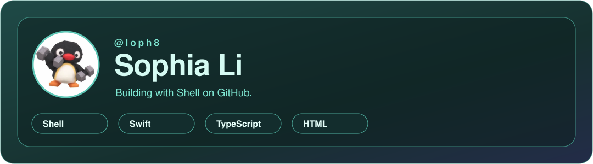
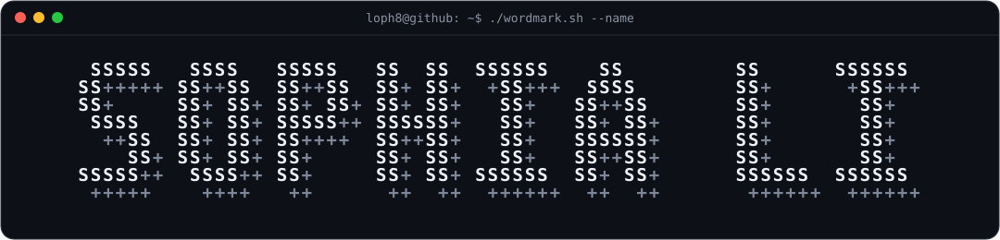
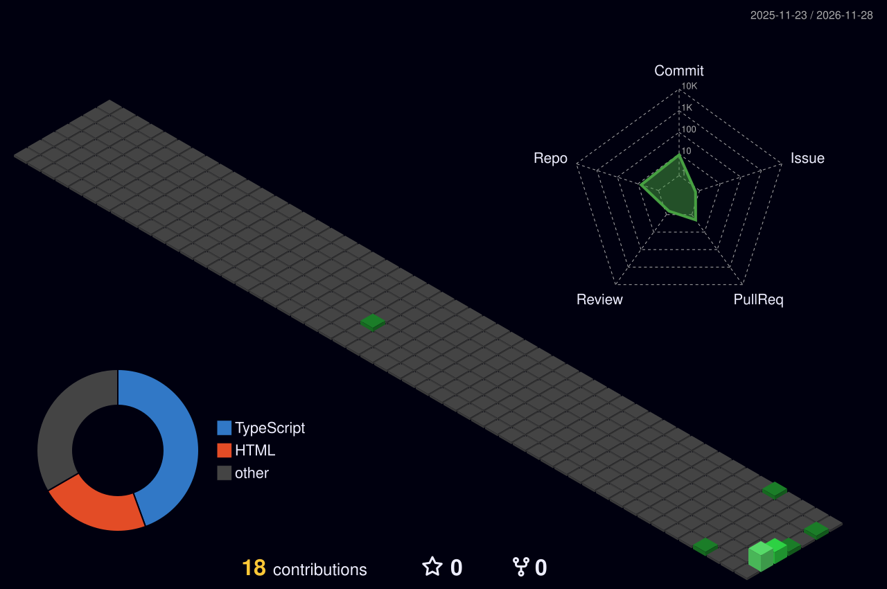

AN EDITORIAL PROFILE · LOPH8

Building useful things and sharing the work in public.

[GitHub](https://github.com/Loph8) · [Website](https://sophiali.us) · [X](https://x.com/loaf4soph)

───────── ◇ ─────────

## My year in 3D

Every building is a day. Taller means more contributions.

## Projects

| Project | What it is | Built with |
| --- | --- | --- |
| [Kairo](https://github.com/Loph8/kairo) | Find the right moment to call family across time zones. iOS widget and availability agents. | Swift |
| [cliff-edge](https://github.com/Loph8/cliff-edge) | | TypeScript |
| [accomplishment-journal](https://github.com/Loph8/accomplishment-journal) | | HTML |
| [my-game](https://github.com/Loph8/my-game) | | Shell |

## Languages

Swift · TypeScript · HTML · Shell

## Contribution trail

